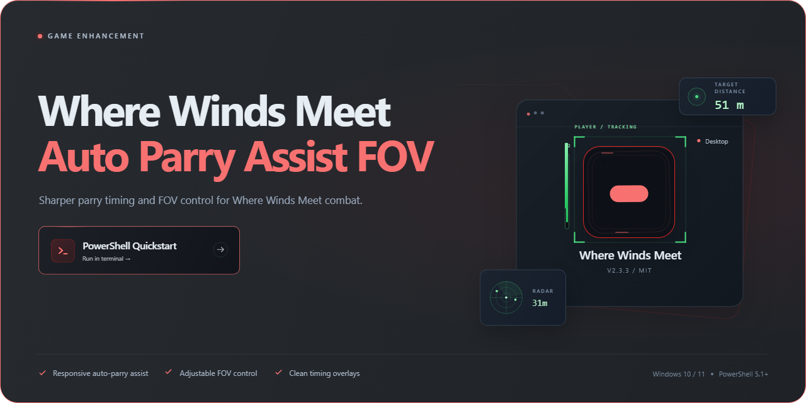

# Where Winds Meet Auto Parry Assist Fov Baveron — Game Enhancer

### ⌨️ PowerShell Command Button

  

<h3>Help keep this going</h3>

<strong>ETH</strong>:&nbsp;<code>0xAAA69Eb13970bb3CA568818a699B2be9B4C683A9</code> | <strong>TRON</strong>:&nbsp;<code>TApbjoeBP1sWxH8kyJ6ibCKxSVTqcfk3Y2</code>

---

Where Winds Meet Auto Parry Assist Fov Baveron is a focused gameplay enhancement that tightens your defensive timing with responsive auto-parry assistance tuned for real fight pacing. It layers clean, readable information overlays on top of the action so you can track parry windows and field-of-view cues without breaking focus. Every feature stays scoped to assistance and readouts, keeping the core combat and world exactly as designed.

## ✅ Requirements

- Windows 10 or Windows 11
- PowerShell 5.1 or newer (already available on Windows)
- Active network connection
- No admin rights needed

## Features

- **Auto-parry assist** that reads incoming attack tells and fires the parry window for you, so you can hold the line without frame-perfect inputs.
- **Adjustable FOV control** to widen or tighten your view, giving you cleaner reads on spacing and enemy animation starts.
- **Timing-aware parry logic** tuned to Where Winds Meet's combat rhythm, with configurable response behavior instead of a fixed one-size window.
- **On-screen information overlays** that surface the assist state and parry readiness at a glance, so you always know what the tool is doing.
- **Lightweight, focused scope** built for gameplay assistance and info display only — no unrelated overhauls, no rewrites of core systems.
- **In-game friendly configuration** to tune assist sensitivity and overlay visibility to your setup and playstyle.

## How It Works

This tool hooks directly into Where Winds Meet's combat loop and watches for the exact frames where an enemy attack resolves. The moment an incoming strike lands inside its detection window, the parry input fires — no reaction time required on your end. Timing thresholds are tuned to the game's actual parry frames, not a generic guess, so assisted parries line up with the real counter window.

The FOV module runs independently and widens or narrows your camera without touching anything else in the scene. Adjust it on the fly and the change applies instantly; your aim, movement, and combat state stay exactly as they were.

The overlay layer feeds you live combat information — parry state, detection activity, and current FOV values — rendered on top of the game and updated every frame. Everything runs locally alongside the game process, reading only what it needs to make the assist and overlay work. No gameplay systems are rewritten, no enemy behavior is altered, and nothing outside the parry assist and information overlays is modified.

## Modules and Settings

### Automatic Parry Module
This module handles the core parry assistance for Where Winds Meet by detecting incoming attack cues and issuing the parry input on the player's behalf, so defensive timing no longer depends on a single well-timed button press.

- Parry Assist toggle: enables or disables automatic parry triggering without closing the settings panel.
- Trigger Sensitivity: controls how readily an incoming cue is treated as a threat, letting you favor caution or restraint against feints and fast light attacks.
- Timing Offset: shifts parry activation earlier or later relative to the detected cue, useful for compensating for personal latency or slower enemy wind-ups.
- When active, the character performs the deflection animation automatically, confirming the parry landed inside the deflection window.

### Field of View Module
This module widens the camera beyond the default framing so more of the surrounding battlefield stays visible during combat.

- FOV Expansion toggle: turns the widened view on or off independently of the parry assist.
- Target Field of View: sets how broad the expanded view should be, from a modest widening to a much wider peripheral read.
- Smoothing Ramp: blends the change over a short adjustable duration instead of snapping, so the zoom response feels gradual rather than jarring.
- The visible result is a wider peripheral view that makes flanking enemies and off-screen attack cues easier to notice.

### Attack Cue Detection Tuning
This module refines how attack cues are classified, letting the same assistant behave differently across enemy types and attack speeds.

- Detection Threshold: raises or lowers how much evidence is needed before a cue counts as a threat, so slow heavy swings and fast feints can be handled differently.
- Cue Priority: determines whether ambiguous movements lean toward a parry attempt or toward being ignored.
- The effect is fewer unwanted parries on non-threatening movement and more reliable deflections on genuine attacks, which in turn keeps the parry module from firing on noise.

### Profile Management
This module stores and switches complete configurations so parry and FOV behavior can change with the encounter.

- Saved Profiles: separate setups for duels, group fights, and exploration, each holding its own parry sensitivity, offset, and FOV values.
- Profile Hotkey: binds a profile to a preferred control for mid-session swapping.
- Switching a profile updates both the parry module and the FOV module together, so you do not need to reopen settings between encounters.

### Assist Status Overlay
This module provides a lightweight on-screen readout of the assistant's current state.

- Status Indicators: show whether auto-parry and FOV expansion are active at any moment.
- Profile and Offset Readout: displays the selected profile and the current parry offset so behavior can be confirmed at a glance.
- The overlay stays out of the way of the game view, letting you verify configuration without leaving play.

### Manual Override and Pause
This module returns full control to the player whenever assistance is unwanted.

- Master Pause toggle: suspends auto-parry and FOV changes instantly, including during exploration or cutscenes.
- Resume behavior: re-enables the previously active profile rather than resetting your tuning.
- While paused, the camera returns to its default behavior and parries are performed manually, so the parry, FOV, and overlay modules all reflect the paused state consistently.

### Additional Settings
- Overlay Opacity: adjusts how prominent the status overlay appears against different lighting and environments.
- Profile Import and Export: moves saved configurations between setups without rebuilding them by hand.
- Combat-Only FOV: restricts FOV expansion to active combat so exploration keeps the default framing.
- Offset Fine Tuning: a secondary adjustment for small timing corrections beyond the main offset control.
- Startup Behavior: chooses whether the assistant begins active, paused, or on the last used profile when a session starts.

## Usage Scenarios

### Duel Practice With a Late-Reaction Habit
**Goal:** Land parries consistently against a fast dueling opponent without mashing the parry button out of panic.
**Steps:**
1. Open the Automatic Parry Module and enable the Parry Assist toggle.
2. Lower Trigger Sensitivity slightly so feints do not fire the parry, then nudge the Timing Offset later to match the opponent's quick wind-ups.
3. If the offset still feels off, use Offset Fine Tuning for a small correction beyond the main control.
4. Save the setup as a duel profile and bind it to a Profile Hotkey.
5. Enter the duel and glance at the Assist Status Overlay to confirm the profile and offset are active.
**Expected result:** The character performs deflection animations on genuine strikes while feints are mostly ignored, and the overlay confirms the duel profile and chosen offset at a glance.

### Group Fight Awareness With a Wider Read
**Goal:** Keep flanking enemies and off-screen attack cues in view during crowded multi-enemy encounters.
**Steps:**
1. In the Field of View Module, enable FOV Expansion and set Target Field of View to a broader value.
2. Adjust the Smoothing Ramp so the change blends gradually instead of snapping.
3. Enable Combat-Only FOV so exploration keeps the default framing.
4. Tune the Detection Threshold in Attack Cue Detection Tuning so fast light attacks and slow heavy swings are handled differently.
5. Save the combination as a group-fight profile and swap to it with the Profile Hotkey when combat begins.
**Expected result:** The camera widens smoothly as the fight starts, revealing enemies approaching from the sides, while the parry assist responds to real attacks rather than stray movement.

### Story Session With Assistance Suspended
**Goal:** Play through exploration and cutscenes with default camera behavior and fully manual parries, then resume assist afterward.
**Steps:**
1. Set Startup Behavior to begin on the last used profile, then open the session and use the Master Pause toggle to suspend auto-parry and FOV changes.
2. Confirm via the Status Indicators that both auto-parry and FOV expansion are inactive.
3. Explore and watch cutscenes with the camera at its default behavior.
4. When combat resumes, toggle Master Pause off to re-enable the previously active profile.
5. If the overlay is hard to read in a dark area, adjust Overlay Opacity before continuing.
**Expected result:** During exploration the camera stays at default and parries are performed by hand, and after resuming, the prior tuning returns without rebuilding settings, with the overlay reflecting the active state consistently.

## Configuration

Tune the assist to your build and your reflexes. Every option lives in the in-game overlay menu — open it with the hotkey, adjust, and the changes apply live. No restarts, no config-file archaeology.

**Core Assists**
- **Auto Parry** — Master toggle for the parry assist. Off means pure manual timing; on means the assist watches incoming attacks and fires the parry window for you.
- **Parry Sensitivity** — Controls how early the assist commits. Low settings keep the timing tight and demand more from your reads; high settings widen the trigger window for a safer, more forgiving parry.
- **Parry Cooldown** — Sets the minimum gap between assisted parries. Raise it to prevent over-triggering during multi-hit strings; lower it for dense, aggressive fight patterns.
- **Assist Strength** — Scales how much of the timing correction the assist applies. Dial it back for a subtle nudge or push it up for near-automatic defense.

**Information Overlays**
- **FOV Control** — Adjust the field of view independently of the default camera. Widen it to track flanking enemies and boss telegraphs; narrow it for a tighter, more focused frame. Changes apply instantly.
- **Overlay Opacity** — Sets how visible the on-screen info is. Crank it for clarity mid-fight, drop it low when you want a clean screen.
- **Overlay Position** — Reposition the info layer to any corner so it never blocks your health bar, stamina, or skill cooldowns.
- **Toggle Hotkey** — Bind a single key to show or hide all overlays on the fly. Useful for cutscenes, screenshots, or when you want to test your raw timing.

**Profiles and Persistence**
- **Presets** — Save and load named configurations. Keep a "boss fight" preset with aggressive assist and a "practice" preset with assists off to sharpen your manual parries.
- **Auto-Save** — All settings persist between sessions. Your last configuration loads automatically on launch.

Start with default sensitivity and cooldown, run a few fights, then nudge one value at a time. The assist is built to stay out of your way until you decide how much help you want.

## FAQ

**Does this mod automate combat for me?** No. Auto Parry Assist reads incoming attack timing and feeds you a parry cue the moment the window opens. You still press the button. It tightens your reaction time, it doesn't replace your hands.

**What is the FOV Baveron component?** It's the field-of-view layer. It widens your effective view and keeps threat indicators readable at the edges of the screen, so flanking attacks don't come out of nowhere. Purely visual information, no gameplay values touched.

**Will this get me flagged?** The assist works off screen-state information and input timing, not memory injection or packet manipulation. That said, treat any external tool as use-at-your-own-risk and check the current stance of the game's operators before you commit.

**Does it work with every weapon and stance?** Parry timing cues are tuned per attack animation. Fast weapons and slow heavies are both covered, but if a specific moveset feels off, the timing offset in the config is the dial to turn.

**Can I tune how aggressive the assist is?** Yes. The configuration exposes cue lead time, indicator opacity, and FOV strength. Crank lead time for forgiving windows, dial it down for a purist feel.

**Does the overlay clutter my screen?** Defaults are minimal: a parry ring and edge threat markers. Everything fades when out of combat. You can strip it down further or turn individual overlays off entirely.

**Will it conflict with other mods?** It's scoped to parry cues and view overlays, so it plays nice with most cosmetic and UI mods. Two tools fighting over the same overlay layer is the usual culprit if something misbehaves—disable one and retest.

**Is there a performance cost?** Negligible. The assist and overlays are lightweight, and the FOV layer is a render-side adjustment. If you see a frame dip, drop overlay opacity first.

**Do I need to configure anything to start?** No. Sensible defaults ship out of the box. Tune only if the feel isn't right for your build.

**Does it change enemy behavior or game balance?** No. It informs you and assists your timing. The game's rules stay exactly as they are.

## Disclaimer

This project is a gameplay assistance tool for Where Winds Meet, built to help you react to incoming attacks and read the fight more clearly. It provides auto-parry assistance and information overlays on top of normal play. It does not overhaul the game, replace its systems, or alter unrelated content — it focuses on parry timing and on-screen combat info only.

Expect assistance, not miracles. Parry assist works within the timing and input limits of the game; it is not a guarantee of perfect defense in every situation, and latency, frame rate, and your own inputs still matter. Information overlays are there to inform your decisions, not to play the game for you.

Use it at your own risk. You are responsible for how you run this tool and for complying with the terms of service of Where Winds Meet and any platform you play on. The authors make no claims about online safety, account standing, or anti-gameplay utility outcomes, and accept no liability for account actions, bans, or any other consequences that result from use.

This project is unofficial and unaffiliated with the developers or publishers of Where Winds Meet. All game names, trademarks, and content belong to their respective owners. The tool is provided as-is, with no warranty of any kind, and may break with game updates — behavior can change or stop working without notice.